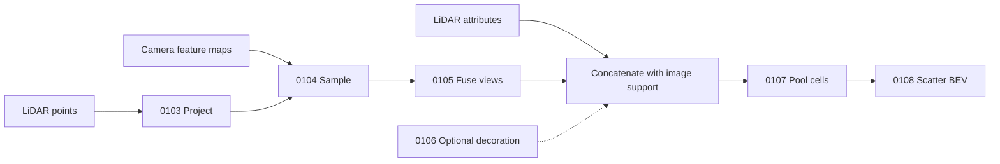

# Autonomy perception practice

Work through one editable answer cell at a time in Emacs/Jupyter. Start with
known geometry and small supplied feature maps; no dataset or checkpoint is
required. Each question is a script with top-level probes, inspectable eval data,
and a companion eval script containing complete reference versions.

## Practice sequence

| Workout | What to predict before coding | Useful failure to inspect |
|---|---|---|
| 0103 Multi-camera projection | Camera coordinates and image centers for three points | Reversed transform, swapped uv, missing view |
| 0104 Bilinear feature sampling | Four corner weights on an affine ramp | Last-column boundary, wrong image-to-feature map |
| 0105 Masked view fusion | The weighted mean and its denominator | NaN padding, zero confidence, overflowing mass |
| 0107 Voxel/pillar pooling | Sorted occupied rows, counts, inverse IDs | Lost duplicates, mixed batches, wrong z collapse |
| 0108 BEV scatter | Count-weighted means on an asymmetric grid | Mean of voxel means, overwritten collisions |
| 0109 Camera/LiDAR to BEV | The features of one point through every stage | Missing image support accidentally erases LiDAR |
| 0106 Point decoration, optional branch | Centroid and center offsets of a point | Centroid includes excluded padding |

The first six-component curriculum includes point decoration, but the basic
capstone concatenates supplied LiDAR features directly. Add decoration as a
richer branch once the composition works. Existing strict projection (0044)
and NumPy voxel pooling (0066) keep their earlier APIs.



## Vision foundation model path

Continue with supplied token backbones before introducing a real checkpoint.
Each workout isolates a different contract, so inspect the first incorrect
representation rather than treating every failure as an attention problem.

| Workout | Connection to perception | Useful failure to inspect |
|---|---|---|
| 0027 Patch embedding | Image patches → row-major spatial tokens | Channels scrambled inside patches; wrong runtime grid |
| 0110 Dense feature layout | Spatial tokens → rectangular feature map | Prefix included as a pixel; height/width ordering swapped |
| 0111 Positional grid interpolation | Source positional grid → target rectangular grid | Prefix interpolated; wrong half-pixel coordinates |
| 0112 Frozen feature adapter | Frozen token backbone → trainable dense camera features | Correct forward with detached image gradients; training dropout left on |
| 0113 Geometry-guided BEV attention | Projected BEV height anchors → sampled camera features → updates | Camera/height key order; invalid weights; all-masked row |

**Grid shape and prefix count are supplied facts.** Runtime patch output may
be rectangular even when the constructor retains a nominal square patch count.
Never recover `(Hf,Wf)` from `sqrt(token_count)`. Remove the declared prefix
before spatial reconstruction; positional interpolation copies prefix entries
exactly and resizes only the spatial grid. The positional workout uses bilinear
`align_corners=False`, without antialiasing. Resizing position embeddings does
not itself determine a camera feature map's geometric alignment.

For the unpadded, nonoverlapping patch extractor in 0027, patch-center image
coordinates are `P*column + (P-1)/2` and `P*row + (P-1)/2`. Its affine image-to-
feature transform scales by `1/P` and translates by `-(P-1)/(2*P)`. If image
preprocessing crops or resizes first, compose that preprocessing transform in
image-to-input order before the patch transform. This derivation applies to
this extractor; a different backbone needs its own explicit feature contract.

0112 freezes backbone **parameters** and keeps its train/eval state at eval.
The adapter follows the wrapper's requested mode. Freezing does not imply
`no_grad` around the backbone: input-image gradients may still be requested.
Its inference-only reference is qualified only for baseline forward use; the
other two complete versions preserve input and trainable-adapter gradients.
Construct a fresh instance after editing the class, and copy the fixture's
explicit adapter weights before comparing outputs.

```python
adapter_data = get_eval_data("0112_frozen_feature_adapter_eval.py")
case = adapter_data["numbered_images"]
# run_case in the question constructs your class using a fresh supplied
# backbone and the fixture's explicit adapter weights.
actual = run_case(**case.inputs)
retained = compare(case, actual)
results = replay("0112_frozen_feature_adapter_eval.py", run_case)
```

The adapter returns maps plus explicit `feature_from_image` metadata. Expand
that metadata over camera views deliberately before projection/fusion; preserve
its declared coordinate convention. The transform must satisfy the feature
sampler's finite, invertible affine contract. Core fixtures use CPU float32/
float64 and small supplied models; they require no model download.

0113 uses camera-major, then height-anchor-major keys. Scores are scaled dot
products between queries and sampled keys; normalization excludes unsupported
anchors. An all-masked query has zero weights, zero update and false support.
The returned diagnostics retain projection, samples, validity, scores and
weights. A residual addition to the query is a separate operation. The
`adapted_maps` case records one local supervised adapter update on a frozen
identity token backbone; inspect its lineage rather than assuming those maps
came from a pretrained model.

For a live backward experiment, keep the adapter output attached, pass it as
`image_features` to attention with matching query channels and explicit
metadata, and differentiate the update loss. Gradients reach eligible image
inputs and adapter weights; frozen backbone parameters remain without gradients.
Coordinate probes avoid pixel knots, depth cutoffs and hard-mask transitions.

| Workout | Complete reference progression | Highest qualified stages |
|---|---|---|
| 0027 | Patch loop → unfold/reorder → equivalent strided convolution | All production |
| 0110 | Row copy → reshape/permute view → contiguous output | All production |
| 0111 | Four corners → separable interpolation → framework interpolation | All production |
| 0112 | Dense-map adapter → token-side adapter → inference-only adapter | Production → production → baseline |
| 0113 | Query loop → broadcast keys → query chunks | All production |

Real-checkpoint exploration is optional. Record the exact checkpoint, primary
implementation source, preprocessing, prefix layout, runtime grid, feature
channels and image-to-feature coordinates before adapting it. A tensor shape
alone cannot establish patch stride, receptive-field center, or crop alignment.

## Inspect, change, replay

Run the imports and your answer cell, then inspect a concrete case. Example
cells are included in each question:

```python
eval_data = get_eval_data("0103_multi_camera_project_eval.py")
case = eval_data["optical_axis_and_edges"]
case.inputs, case.expected
actual = project_points(**case.inputs)
result = compare(case, actual)
result.passed, result.diagnostics, result.actual, result.expected
```

Retain `result`, edit the answer, and rerun its cell. Use `replay` to rebuild
fresh inputs; the earlier failure remains available for comparison:

```python
results = replay("0103_multi_camera_project_eval.py", project_points,
                 names=["optical_axis_and_edges", "masked_nan_padding"])
failures = {name: r for name, r in results.items() if not r.passed}
check("0103_multi_camera_project_eval.py", stage="production")
```

An eval case has a purpose, stage, inputs, and expected values or an expected
exception. Inspect diagnostics rather than treating the final boolean as the
entire result. Changing fixture inputs before comparing makes the oracle stale.
The [interactive eval guide](interactive-eval.md) describes snapshots, exceptions,
shared state, and fresh replay in detail.

For backward exploration, use live outputs before they are detached into a
comparison record. The capstone's `live_feature_gradients` case supplies leaf
camera maps and LiDAR attributes:

```python
case = get_eval_data("0109_perception_bev_eval.py")["live_feature_gradients"]
scene = case.inputs["scene"]
live = perception_bev(scene)
live["bev"].sum().backward()
scene["features"].grad, scene["point_features"].grad
```

The capstone returns named intermediate tensors, not only the BEV. Inspect
`uv`, `projected_valid`, `samples`, `sampled_valid`, `fused`, `image_supported`,
`point_features`, `indices`, `counts`, `means`, and `inverse` to find the first
incorrect stage. Replace the fusion helper temporarily with an equal-view mean;
`weighted_two_views` then reveals where a confidence mistake enters the BEV.
Restore the helper and replay with fresh inputs.

## Geometry and support contracts

- Ego axes are x-forward/y-left/z-up in meters. Camera axes are
  x-right/y-down/z-forward. Row points transform with
  `points @ R.T + t` using `T_camera_from_ego`.
- Intrinsics and rigid transforms have explicit shapes and finite calibration.
  Unavailable cameras retain valid calibration placeholders.
- Image coordinates identify integer pixel centers, with inclusive support
  `[0,W-1]` and `[0,H-1]`. Camera-z depth must be strictly greater than
  `min_depth`. The feature sampler applies a supplied affine
  `feature_from_image`; tensor sizes alone do not determine alignment.
- Projectable and samplable do not establish that a point is unoccluded.
  A depth-based visibility extension needs a separate observation and tolerance.
- Physical voxel bounds are half-open. Decide membership before computing a
  floor index. Subtraction can round an interior point onto the upper cell;
  correct only already-included indices to the final cell after guarding
  representability. Clipping before membership would admit outside points.
  The `near_zero_upper_float32` and `near_zero_upper_float64` cases expose this
  with literal expected groups and centroid offsets.
- Metadata uses xyz order; sparse occupied
  indices use `[batch,z,y,x]`. Dense BEV uses `[B,C,Y,X]`.
- Pillar pooling collapses grouping z while retaining the declared 3D bounds.
  BEV scatter collapses z using **point-count-weighted means**, preserving direct
  point-to-pillar equivalence. Occupancy distinguishes a zero feature from no
  contributing points.
- Padding must be removed before arithmetic. Masked NaNs cannot be made safe
  by multiplying them by zero. Each workout states which masked inputs may be
  nonfinite; active values and metadata are validated.

Core floating tensors share float32/float64 dtype and device. Counts and inverse
IDs are int64; support masks are boolean. Baseline fixtures keep all batch/view
axes, even when their size is one. Empty point sets remain valid.

## References and deeper stages

Baseline, follow-up, and production are cumulative verifier stages. Reference
version numbers describe algorithms; they are not aliases for these stages.
Run each version only within its stated numerical and resource domain.

| Workout | Complete reference progression | Highest qualified stages |
|---|---|---|
| 0103 | Per-camera → broadcast → point chunks | All production |
| 0104 | Four corners → vectorized gathers → point chunks | All production |
| 0105 | Transparent mean → conditioned mean → point chunks | Follow-up → production → production |
| 0106 | Voxel loop → grouped descriptors → conditioned geometry | Follow-up → follow-up → production |
| 0107 | Group loop → unique/scatter → sorted segments | All production |
| 0108 | Explicit numerator → conditioned index addition → grouped scatter | Follow-up → production → production |
| 0109 | Transparent composition → vectorized composition → chunked composition | Follow-up → production → production |

The numerical fixtures include overflowing confidence mass, large coordinate
ranges, and finite maximum-magnitude means. Conditioned reductions keep those
forward examples finite. Ordinary interior feature/weight gradients are checked
independently. Floating boundary corrections have the derivative policy stated
by each reference; finite forward output does not guarantee representable
confidence derivatives for every extreme input.

Gradient probes avoid projection cutoffs, pixel knots, and voxel boundaries.
Hard support, floor assignment, sorting, and integer IDs are discrete. With fixed
membership, feature means and point decoration retain ordinary derivatives.
Do not interpret a finite-difference failure across an assignment change as an
ordinary smooth backward bug.

Point chunks bound forward geometric or reduction temporaries; full validation,
required pairwise outputs, and saved autograd state still have costs. Voxel
pooling stores points and occupied cells. Dense BEV inherently costs
`B*C*Y*X`; a grouped scatter is not a sparse output representation.

## Optional experiments

Run the experiment functions explicitly from the eval scripts after correctness:
`benchmark_projection`, `sampling_experiment`, `benchmark_fusion`,
`benchmark_decoration`, `benchmark_pooling`, `bev_experiment`, and
`perception_experiment`. Compare only overlapping qualified domains. Reports
state workload, device/dtype, warmup, repeats, timing variability and numerical
error. Forward storage estimates, measured allocator peaks, and retained backward
state are distinct. Correctness does not include a speed threshold.

Vision experiments are also opt in: `benchmark_patch_embedding`,
`benchmark_layout`, `benchmark_positions`, `benchmark_adapters(inputs)`, and
`benchmark_attention(inputs)`. Adapter version comparison uses the declared
inference mode; it does not qualify training throughput or gradient behavior.
Real data and pretrained backbones remain optional exploration.

## Qualification record

The core qualification exercised all 21 advertised reference/stage combinations,
all 21 saved-candidate stage combinations, and the real capstone setup/filled
answer at all three stages. Raising poison in excluded teaching/reference/
experiment cells checks that learner evaluation selects imports, setup and answer
while loading verifiers without reference execution.

Actual Emacs29.3 with emacs-jupyter and ipykernel executed 28 separate
wrong-answer → inspect → corrected-definition → fresh-replay cells, followed by
a live camera-map/LiDAR backward cell. The owned verification kernel retained
ordinary globals and earlier failures across cells. These small CPU runs qualify
this interactive path; they do not measure CUDA throughput or require a dataset.

Commands, retained reports and logs are recorded in the local qualification
ticket. Final integration review checks Standards and Spec separately before the
track is considered fully delivered.

The vision qualification exercised all 15 advertised reference/stage scopes
and all 15 filled-question saved-candidate stage combinations. The adapter
case runner constructs fresh modules and copies explicit weights. Actual
Emacs/Jupyter executed 23 further stateful cells, retaining a rectangular
layout failure, a correct-forward/missing-input-gradient failure, and a
backbone-training/buffer failure before corrected fresh replay. A final live
adapter-to-BEV-attention backward reached image inputs and adapter weights
while keeping backbone parameters frozen. The retained failure data and
corrected gradient/state observations are recorded in the qualification
artifacts.

The default repository gate ran 113 reference scripts, and the test gate ran
49 tests with seven optional Textual skips. These gates qualify their stated
fixtures; final Standards/Spec review still audits the complete integration
and rechecks regression fixes for its geometry-bound and metadata findings
before delivery.
